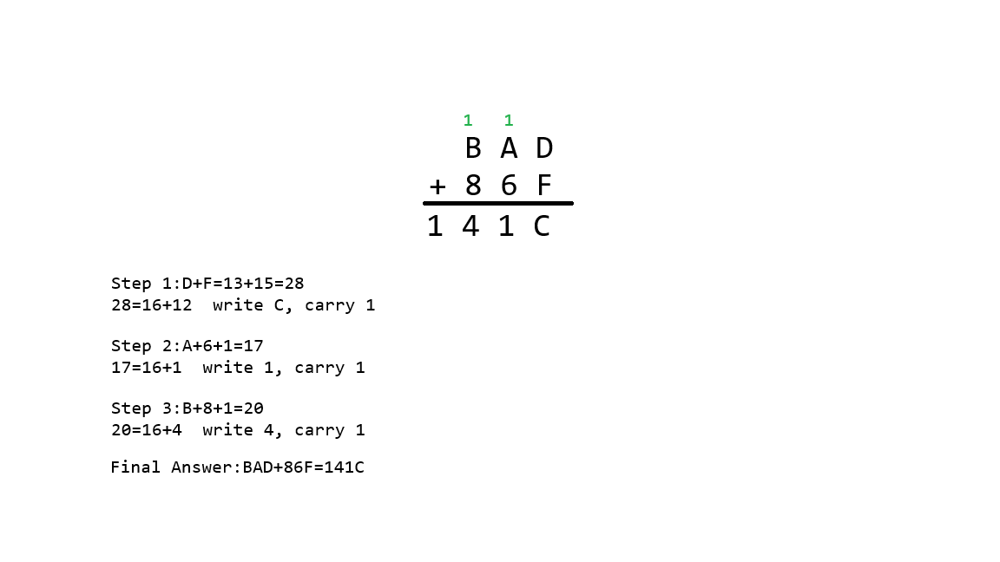

# CS301 Module 8 — Skills Demonstration

## Problem 1: Hexadecimal Addition

Add the hexadecimal numbers BAD and 86F using column addition.

**Final Answer:**

BAD + 86F = 141C

The image below shows my calculations, including carrying in base 16.

## Problem 2: Modern Examples of Programs Being Treated as Data

### 1. Software Updates

When we download a software update, the program is treated as data because its instructions are transferred over the internet and stored on our device. Once installed, the computer can execute the updated program.

### 2. Java Programs

Java source code is stored as text in a file. A compiler reads that code as data and converts it into bytecode. The Java Virtual Machine then executes the bytecode.

### 3. Web Browsers and JavaScript

When we visit a website, the browser downloads JavaScript code as data from a web server. The browser then interprets or compiles that code so the website can perform interactive tasks.

## Problem 3: TOY Machine Instructions

The TOY machine uses 16-bit instructions represented by four hexadecimal digits. The first hexadecimal digit identifies the operation.

| Binary | Hex | TOY Instruction |
|---|---|---|
| 0001001000110100 | 1234 | R[2] <- R[3] + R[4] |
| 1111111111111111 | FFFF | halt |
| 1111101011001110 | FACE | halt |
| 0101011001000100 | 5644 | R[6] <- R[4] & R[4] |
| 1000000000000001 | 8001 | R[0] <- 01 |
| 0101000001000011 | 5043 | R[0] <- R[4] & R[3] |
| 0001110010101011 | 1CAB | R[C] <- R[A] + R[B] |
| 0101111111111111 | 5FFF | R[F] <- R[F] & R[F] |
| 1010100010001000 | A888 | R[8] <- M[88] |
| 0111011101110111 | 7777 | R[7] <- R[7] ^ R[7] |
| 1100110011001100 | CCCC | if (R[C] == 0) PC <- CC |
