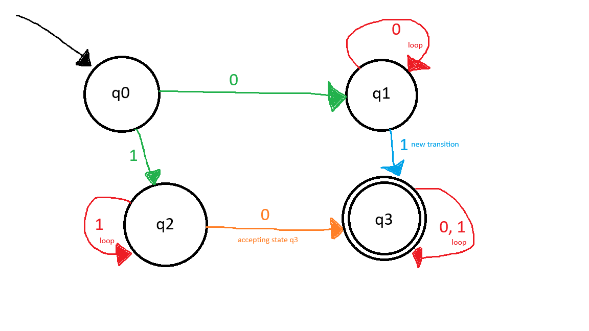
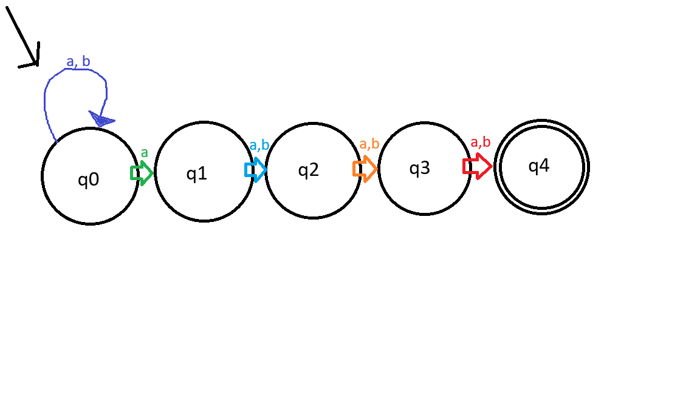

# CS301 Skills Demonstrations

This repository contains my Java programming assignments and skills demonstrations for CS301.

## Module 6 — Regular Expressions and Automata

### Phone Number Validation
`MatchPhoneNumber.java` uses regular expressions to validate phone numbers.

### Deterministic Finite Automaton (DFA)
This DFA accepts binary strings containing at least one `0` and at least one `1`.

### Nondeterministic Finite Automaton (NFA)
This NFA accepts strings over `{a, b}` whose fourth-to-last character is `a`.

